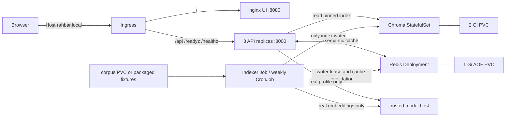

# RAHBAR

[](https://github.com/m-hamza-atif/RAHBAR/actions/workflows/ci.yml)

RAHBAR retrieves public university policy passages, answers with source/section/page
citations, and declines unsupported questions. Three FastAPI readers share Chroma
and a revision-scoped Redis semantic cache. A separate Job extracts/OCRs, cleans,
chunks, embeds and stores documents. The UI renders model output as untrusted text.
The FAST-NUCES corpus and fictional CI fixtures are deliberately separate profiles.
Fixture answers are not university policy advice.

The badge points to the actual workflow; it does not certify unpublished changes.
See [final review](docs/FINAL-REVIEW.md) for measured results and pending work.



## Prerequisites

Work from the team's current `dev` checkout. Do not copy the starter ZIP over it.
Use Python 3.12, Git, Docker Desktop with Linux containers, kubectl, kind 0.27.0,
kubeconform 0.6.7 and Trivy 0.76.2. The fixture cluster pins Kubernetes 1.32.2,
Calico 3.29.3, metrics-server 0.7.2 and Traefik 3.6.2. Allow enough Docker resources
for this cluster plus existing workloads; the assignment's minikube target is
4 CPUs/6144 MiB. Do not reset Docker/WSL disks.

The following commands use Windows PowerShell at the repository root. Put portable
tools on PATH. Linux/WSL users can run `bash scripts/install_ci_tools.sh` and add
`$PWD/.tools` to PATH; use `.venv/bin/python` instead of Windows venv paths. Virtual
environments are OS-specific. The Makefile is a bash convenience wrapper.

```powershell
python -m venv .venv
.venv\Scripts\python -m pip install -r api/requirements-dev.txt -r indexer/requirements-dev.txt -r corpus/requirements-dev.txt
.venv\Scripts\python -m pytest --cov=api/app --cov-fail-under=60
.venv\Scripts\ruff check api indexer eval corpus
.venv\Scripts\mypy --config-file api/pyproject.toml api/app
.venv\Scripts\mypy --config-file indexer/pyproject.toml indexer/pipeline
.venv\Scripts\python scripts/validate_manifests.py
```

## Clean fixture deployment

This profile needs no models, downloaded PDFs, Docker Hub login or Secret. It uses
real Chroma 1.0.12 and Redis, deterministic stub embeddings/generation, 384 dimensions,
floor .15, cache .90 and chunks 512/64. Choose an unused cluster name/port before
creation. The helper writes `.artifacts/kubeconfig`, preserving the default context.
Kind exposes only loopback 18080 through the infrastructure Ingress controller.
The pod subnet is `10.244.0.0/16`; the helper seeds Calico with that same range
before startup. Choose a different non-overlapping range in `k8s/kind.yaml` before
creating a cluster if your host/model network uses it. Older clusters created
with `192.168.0.0/16` overlap Docker Desktop's Windows-host address and require a
new dedicated cluster to use these defaults; `--existing` does not migrate CIDRs.

```powershell
docker build --provenance=false -t rahbar-api:dev api
docker build --provenance=false -f indexer/Dockerfile -t rahbar-indexer:dev .
docker build --provenance=false -t rahbar-ui:dev ui
.venv\Scripts\python scripts/cluster.py --name rahbar-b
$env:KUBECONFIG = (Resolve-Path .artifacts/kubeconfig).Path
docker save --platform linux/amd64 -o .artifacts/images.tar rahbar-api:dev rahbar-indexer:dev rahbar-ui:dev
kind load image-archive --name rahbar-b .artifacts/images.tar
.venv\Scripts\python scripts/deploy.py --context kind-rahbar-b --overlay k8s/overlays/ci
```

The script renders Kustomize and uses `kubectl apply -f -` in this exact order:

1. Namespace, ServiceAccounts, ConfigMap, four Services, PVCs, data workloads and
   NetworkPolicies; install the CronJob suspended.
2. Wait for Chroma and Redis readiness.
3. Create `Job/indexer` only if absent; wait for Complete.
4. Apply API/UI, HPA and Ingress; wait for rollouts and at least three ready API
   replicas. Restore the profile's desired CronJob setting.

Do not use raw `kubectl apply -k` for a clean bootstrap: it races indexing against
datastore startup. A completed bootstrap Job is retained, so harmless applies do
not rerun indexing. Use `--reindex` for new corpus or image versions. CI keeps the
weekly schedule suspended. Dev/prod schedule Sunday 02:00 Asia/Karachi.

```powershell
curl.exe --fail http://127.0.0.1:18080/readyz -H "Host: rahbar.local"
$body = @{question="When is a student placed on academic warning?"} | ConvertTo-Json
Invoke-RestMethod http://127.0.0.1:18080/api/ask -Method Post -Headers @{Host="rahbar.local"} -ContentType application/json -Body $body
.venv\Scripts\python eval/run_eval.py --api http://127.0.0.1:18080 --host rahbar.local --golden eval/fixtures/golden.fixture.yaml --baseline eval/fixtures/baseline.fixture.json --out .artifacts/results.fixture.json
.venv\Scripts\python scripts/acceptance.py --context kind-rahbar-b
```

For the browser, add `127.0.0.1 rahbar.local` to your hosts file with appropriate
desktop permission, then open http://rahbar.local:18080. The Host rule is required.
Capture a screenshot only from the real running page; no screenshot is fabricated.

## Endpoints and probes

| Method | Path | Purpose |
| --- | --- | --- |
| GET | /healthz | process alive; no dependency calls |
| GET | /readyz | ready nonempty compatible index and reachable Redis |
| GET | /metrics | Prometheus; internal API Service only |
| POST | /api/ask | question -> answer, citations, retrieved references |

Ingress routes `/api` to API:8000 and `/` to UI:8080, without rewriting the API path.
UI nginx does not proxy the API. Startup/liveness use `/healthz`; readiness uses
`/readyz`. API startup never indexes. Model/dimension/backend conflicts, empty or
building indexes and Redis outages fail readiness without killing healthy processes.
See [API contract](docs/API.md).

## Real-model and public-corpus profile

Base/dev/prod pin nomic-embed-text/768 and llama3.2:3b, top-k 5, relevance floor .35,
cache .90 and chunk size/overlap 512/64 whitespace tokens. Temperature .1 reduces
variation but cannot replace schema/citation validation. Both API and indexer use
the same ConfigMap. Never compare fixture results against the full baseline.

Verify an existing trusted model host and both installed models using `/api/tags`
and `eval/model-manifest.json`. Partner A's localhost is not this computer. Do not
download duplicate models or expose an unrestricted listener. Host firewall/binding
changes need the host owner's approval. Verify from a cluster pod as well as the host.
Base denies external model traffic until an exact destination is configured:

```powershell
# $ModelHostIP is an actually verified cluster-reachable trusted IPv4 address.
.venv\Scripts\python scripts/configure_model.py --ip $ModelHostIP --profile dev
.venv\Scripts\python corpus/fetch.py
.venv\Scripts\python corpus/fetch.py --verify
.venv\Scripts\python scripts/deploy.py --context $Context --overlay k8s/overlays/local --data-only
.venv\Scripts\python scripts/upload_corpus.py --context $Context --source corpus/raw
.venv\Scripts\python scripts/deploy.py --context $Context --overlay k8s/overlays/local
.venv\Scripts\python eval/run_eval.py --api $IngressURL --host rahbar.local --golden eval/golden.yaml --baseline eval/baseline.json --out .artifacts/results.full.json
```

Use a separate real-profile cluster. If deliberately changing an existing fixture
deployment, inspect the change and run `--reindex` after updating the CronJob;
a completed fixture bootstrap Job cannot prove real indexing. The corpus upload
helper requires a suspended schedule and no active Jobs. It copies only files
listed in `_index.json` to the corpus PVC. Raw PDFs/models never enter images.
The generated local overlay is ignored and permits only the supplied /32 TCP endpoint.
See [corpus](docs/CORPUS.md) and [pipeline](docs/PIPELINE.md).

The assignment's minikube alternative, in a new dedicated profile:

```powershell
minikube start -p rahbar-b --driver=docker --cni=calico --memory=6144 --cpus=4
minikube -p rahbar-b addons enable metrics-server
minikube -p rahbar-b addons enable ingress
minikube -p rahbar-b image load rahbar-api:dev
minikube -p rahbar-b image load rahbar-indexer:dev
minikube -p rahbar-b image load rahbar-ui:dev
# dev uses nginx class and ingress-nginx/controller labels.
.venv\Scripts\python scripts/deploy.py --context rahbar-b --overlay k8s/overlays/local --data-only
```

On Docker Desktop, use `minikube -p rahbar-b tunnel` in a second terminal if needed.
Test the actual reachable address with the Host header. The ingress-nginx addon
is a local assignment path: upstream maintenance ended in March 2026
([Kubernetes notice](https://kubernetes.io/blog/2026/01/29/ingress-nginx-statement/)).
The automated kind profile uses Traefik. External production deployments need a
supported controller, TLS, authentication and an approved model endpoint.

Only for hosted generation, create `rahbar-secret` through secure environment/stdin,
add an API `secretKeyRef` for `LLM_API_KEY`, set `HOSTED_BASE_URL`/`LLM_MODEL` and
allow only that provider's required destination. The placeholder Secret is excluded
from every Kustomization. Stub/Ollama have no Secret reference. Never put keys in
YAML, images, logs or shell history. [Cloud operations](docs/CLOUD-OPERATIONS.md)
contains the hosted-secret and release procedure.

## Maintenance, networking and recovery

```powershell
.venv\Scripts\python scripts/deploy.py --context kind-rahbar-b --reindex
kubectl --context kind-rahbar-b -n rahbar get pods,jobs,pvc,hpa
kubectl --context kind-rahbar-b -n rahbar get endpoints api
kubectl --context kind-rahbar-b -n rahbar top pods
kubectl --context kind-rahbar-b -n rahbar logs -l app=indexer
kubectl --context kind-rahbar-b -n rahbar rollout status deployment/api
kubectl --context kind-rahbar-b -n rahbar rollout history deployment/api
kubectl --context kind-rahbar-b -n rahbar rollout undo deployment/api
```

Reindex suspends the schedule and detects unfinished writers before starting a Job
from the applied CronJob template. A renewable Redis lease also excludes concurrent
manual/scheduled writers. Lease loss stops the child writer. Never clear the lease
or restart Redis during indexing. Failed reindex leaves the schedule suspended:
inspect events/logs, repair the cause, then rerun. Retain failed logs before deleting
any Job. Restarting API pods does not repair incompatible vectors.

All application containers run non-root, drop all capabilities, disallow escalation,
use read-only roots and bounded writable /tmp mounts. Dedicated service accounts
mount no tokens. Chroma and Redis write PVCs with fsGroup access. Exactly four
application/data Services are ClusterIP. Automatic service env links are disabled
because Kubernetes' CHROMA_PORT URL collides with Chroma's numeric config parser.

Calico enforces default-deny ingress/egress, allowing DNS; controller -> UI/API;
UI -> API; API/indexer -> Chroma/Redis. UI cannot access either data service.
`scripts/acceptance.py` tests these paths, persistence, repeat indexing, cache
invalidation, model mismatch, three endpoints, HPA and rollout/rollback. It restarts
only this fixture deployment's data processes; use a maintenance window.

API rolling update uses maxSurge 1/maxUnavailable 0, five-second preStop drain,
20-second uvicorn graceful shutdown and 30-second termination grace. Longer requests
can still be interrupted. HPA min 3/max 8 targets 70% of the 100m CPU request and
requires metrics-server. CPU misses I/O-bound generation queues; see engineering Q3.
`kubectl top` snapshots are not automatically peak memory measurements.

```powershell
trivy image --scanners vuln --ignore-unfixed --severity HIGH,CRITICAL --exit-code 1 rahbar-api:dev
trivy image --scanners vuln --ignore-unfixed --severity HIGH,CRITICAL --exit-code 1 rahbar-indexer:dev
trivy image --scanners vuln --ignore-unfixed --severity HIGH,CRITICAL --exit-code 1 rahbar-ui:dev
.venv\Scripts\python scripts/collect_evidence.py --context kind-rahbar-b
python scripts/check_submission.py
```

## CI/CD and human release

CI on dev pushes/main PRs independently runs lint, offline coverage, strict
manifests, three-image build and artifact transfer. Trivy scans those exact images;
only then does Calico-backed fixture e2e run against its original baseline. No
required gate uses continue-on-error. UI is static HTML and has no Node build.

CD runs only on main pushes: tests/manifests -> build/scan/push three github.sha
tags -> pull those exact published images into ephemeral kind -> index fixtures
and evaluate through Ingress. This proves a fixture deployment, not a persistent
real-model cloud deployment. No latest tags or locally substituted dev images.

Humans add DOCKERHUB_USERNAME/DOCKERHUB_TOKEN Secrets, protect main with required
CI and one approval, manually push dev, open/review/merge dev -> main, and record
real Actions/image/PR links. Capture branch-protection and failed-gate/blocked-merge
screenshots, then green fixed checks. Never alter baselines to hide a regression.
AI assistance and verification limits are disclosed in [AI-USAGE](docs/AI-USAGE.md).
